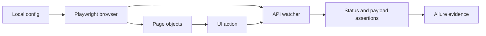

# Logistics TMS API-Aware Test Automation

Java Playwright automation for a private logistics workflow application. The framework combines page objects with API watchers and sessions so a UI action is considered successful only when the backend response and payload satisfy the assertion policy.

Publication approval was obtained for this sanitized portfolio version. Private domains, corporate identifiers, role credentials, locator history, and real test data are excluded.

## What this demonstrates

- Page Object Model for administrative, order, trip, accounting, and reporting areas.
- API response and payload assertions behind UI actions.
- Session helpers that separate authentication from browser navigation.
- Conservative locator healing with scoring, storage, and Allure reporting.
- TestNG suites, retries, and failure cleanup for a large workflow surface.

## Tech stack

Java 17, Maven, Playwright, TestNG, Allure, Log4j2, Gson, PDFBox, and the optional Anthropic Java client. Exact versions are recorded in `pom.xml`.

## Architecture

```text
src/main/java/com/portfolio/logistics/
├── config/       typed environment config
├── drivers/      browser lifecycle
├── pages/        workflow page objects
├── model/        domain test data
├── utils/        API sessions, watchers, exports, and helpers
└── healing/      core scoring, Playwright adapters, storage, and reporting
src/test/java/com/portfolio/logistics/
├── tests/        smoke, auth, workflow, role, accounting, and bug-fix suites
└── retry/        retry and report cleanup hooks
```



## Assertion policy and design decisions

Tests fail when required data or an expected response is missing; they do not silently skip a broken flow. API watchers capture backend write calls so a closed dialog cannot be mistaken for a successful save. Credentials and the optional AI key are read from local configuration or environment variables, never from source. Healing is only applied after deterministic safety checks and is off by default for the optional AI advisor.

## Coverage and status

A source scan found 79 test files and 162 `@Test` methods. The repository contains smoke, authentication, role, orders, trips, accounting, admin, reports, integrations, bug-fix, and self-healing fixture suites. Full execution requires a compatible private environment and disposable credentials.

## Setup and run

1. Install Java 17 and Maven.
2. Copy `config.properties.example` to the local config location expected by the framework.
3. Set `LOGISTICS_*` environment variables or local values for a compatible environment. Never commit credentials or `ANTHROPIC_API_KEY`.
4. Run `mvn -q -DskipTests compile`.
5. Run the smoke or healing self-test suite when the required environment is available.

Allure results, healing state, exports, and screenshots are ignored. No private test result is claimed here.

## Limitations and next steps

The application and real data are not included. The next improvements would be a public contract-test fixture, broader API schema assertions, and CI using ephemeral credentials.

## AI assistance

The framework was developed with AI assistance. The author is responsible for the design, review, sanitization, and execution claims; no claim is made that every line was typed manually.
